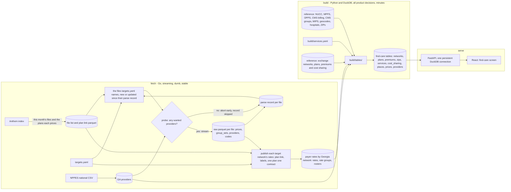
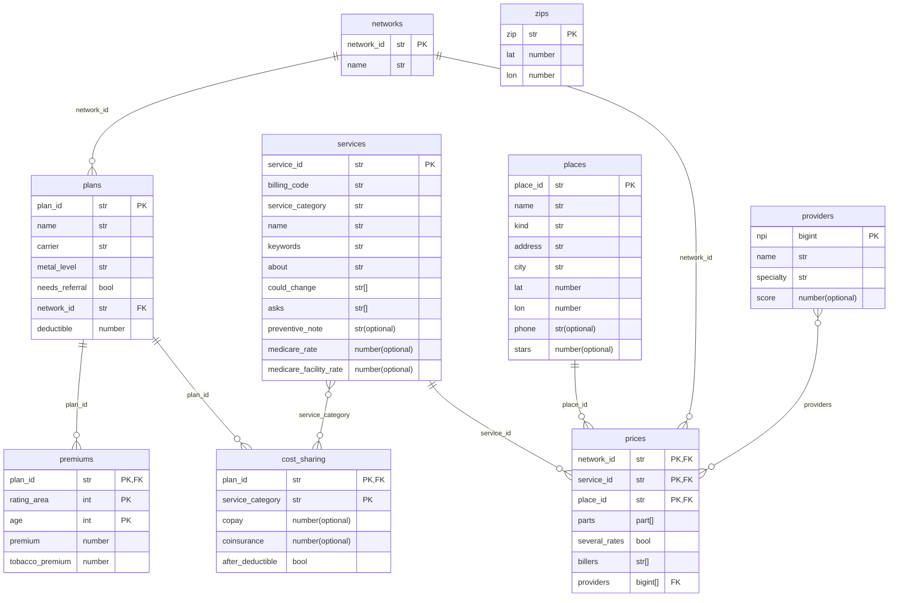
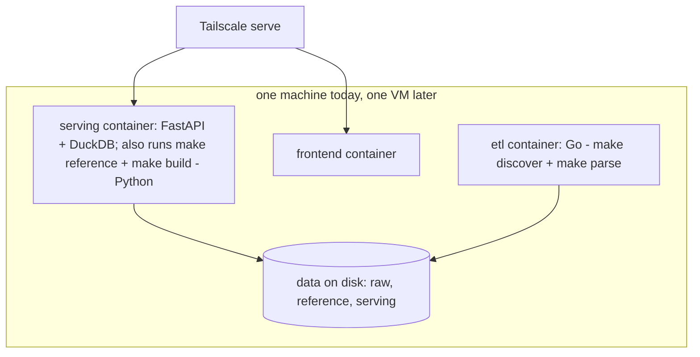

# Architecture

*The standing architecture diagrams — one per **boundary**, not one per
component (a component diagram goes stale the first time a file moves). Read
this for how the pieces fit; read the per-topic docs in the
[AGENTS.md doc map](../AGENTS.md#where-to-look) for how each one works.*

Diagrams render on github.com; the GitHub mobile app sometimes shows the source
instead. Labels are plain text so every Markdown renderer has a chance.

## Layers

| Layer | Tech | Dir | Purpose |
|---|---|---|---|
| Discovery | Go | `etl/discovery/` | Monthly read of Anthem's index: the files it lists (`data/anthem/index_files.parquet`) and the plan→file link (`index_file_plans.parquet`) |
| Extraction | Go (streaming JSON) | `etl/extraction/` | Parses the gzipped MRFs `etl/targets.yaml` names in one pass → raw Parquet, with a parse record per file; a provider probe aborts a download before `in_network` when no wanted provider is in it |
| Reference | Go (NPPES) + Python/DuckDB (NUCC, CMS utilization, MPFS, OPPS, DAC, geocode, MIPS, ZIP centroids, Georgia exchange plans, hospitals) | `etl/nppes/`, `reference/` | External public datasets → dimension Parquet |
| Publish | Python + DuckDB | `ingestion/` | The last step of `make parse`: each target network's rates from the parsed files, keyed on Georgia's network ID (`data/payer_rates/`), the contract the build reads |
| Build | Python + DuckDB | `build/` | Payer rates + reference Parquet → the find-care tables, checking each input's columns and key first; every product decision (who is on a plan, what a price is, where a place is) lives here - [build/build.md](../build/build.md) |
| Serving | Python + DuckDB | `serving/` | Reads the find-care tables in-process via FastAPI (`localhost:8000`) |
| Frontend | React + Vite | `frontend/` | The find-care screen — `localhost:5173` |
| Storage | Parquet + ZSTD | `data/` | `data/anthem/`, `data/nppes/`, `data/reference/`, `data/cms/`, `data/serving/` — [docs/schema.md](schema.md) |

The Go CLI (`etl/`, one module) dispatches from `main.go` to the `discovery` /
`extraction` / `nppes` / `fixture` packages; shared structs, config, and the
progress reader live in `etl/core/`. Docker services: `etl`, `serving`,
`frontend` — each from a multi-stage Dockerfile in
[deploy/](../deploy/README.md) (`prod` target = deployable artifact; compose
runs the `dev` target).

## Data flow

## Serving entity model

The find-care tables, the same model as the ERD on
[#135](https://github.com/wmespi/honest-healthcare/issues/135), which holds the decisions behind
it. Each box reads column, type, then key, and `[]` means a list; a list of keys is checked by
the build, not enforced by a database. Full column notes: [build/build.md](../build/build.md#the-find-care-tables).

## Runtime

The `discover → parse → reference → build` chain runs across the etl (Go) and serving
(Python) containers; `make refresh` runs all of it.
