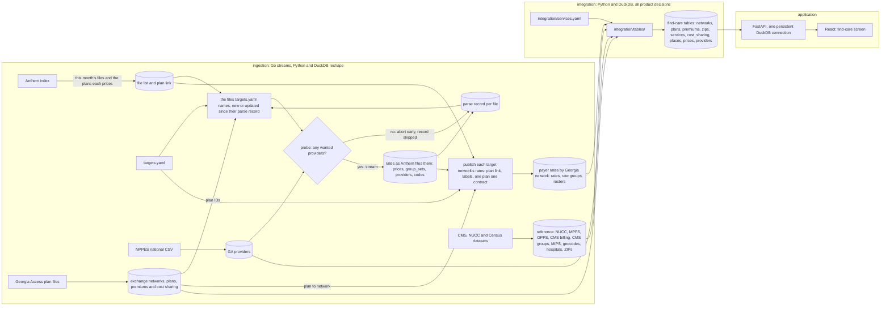
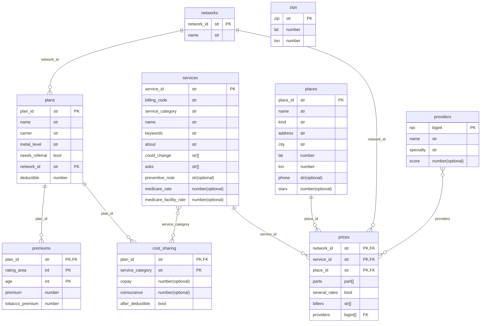
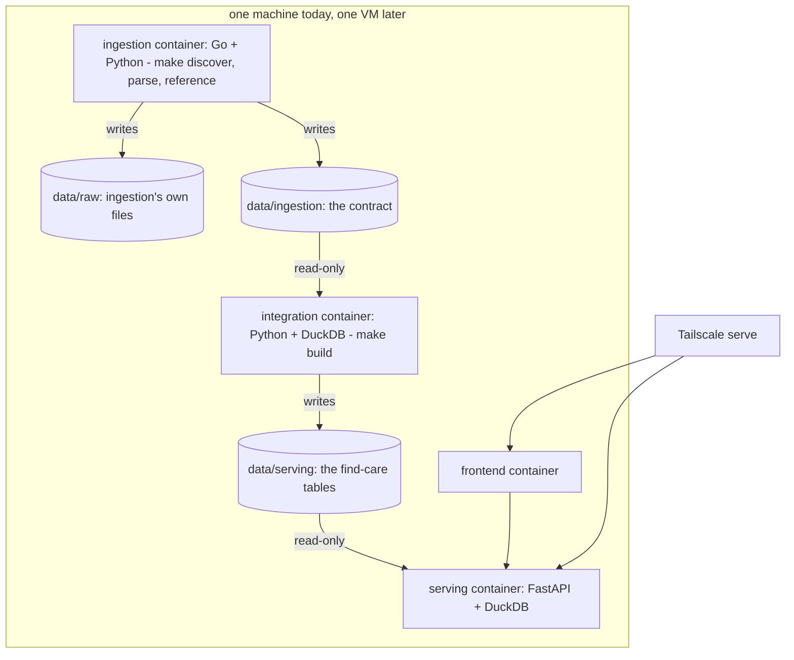

# Architecture

*The standing architecture diagrams — one per **boundary**, not one per
component (a component diagram goes stale the first time a file moves). Read
this for how the pieces fit; read the per-topic docs in the
[AGENTS.md doc map](../AGENTS.md#where-to-look) for how each one works.*

Diagrams render on github.com; the GitHub mobile app sometimes shows the source
instead. Labels are plain text so every Markdown renderer has a chance.

## Layers

The pipeline is three layers, each in its own container, and each reads only what the layer before it delivers ([decided on #135](https://github.com/wmespi/honest-healthcare/issues/135#issuecomment-6669410856)).
A layer can change freely as long as what it delivers keeps its contract, so another payer's ingestion can differ from Anthem's while integration and the app read the same tables.

| Layer | Container | Code | Reads | Writes |
|---|---|---|---|---|
| Ingestion | `ingestion`: Go + Python/DuckDB | `ingestion/` | Anthem, NPPES, Georgia Access, CMS, NUCC, Census | `data/raw/`, its own files, and `data/ingestion/`, the contract integration reads |
| Integration | `integration`: Python/DuckDB | `integration/` | `data/ingestion/`, read-only | `data/serving/`, the find-care tables |
| Application | `serving`: FastAPI + DuckDB, `localhost:8000`; `frontend`: React + Vite, `localhost:5173` | `serving/`, `frontend/` | `data/serving/`, read-only | nothing |

The contract between ingestion and integration is the datasets in `integration/inputs/datasets.py`, each with its columns and key, which the build checks before it reads them; between integration and the app it's the find-care tables below.
The on-disk layout is in [docs/schema.md](schema.md).

Inside ingestion:

| Step | Tech | Dir | Purpose |
|---|---|---|---|
| Discovery | Go | `ingestion/etl/discovery/` | Monthly read of Anthem's index: the files it lists (`data/raw/anthem/index_files.parquet`) and the plan→file link (`index_file_plans.parquet`) |
| Extraction | Go (streaming JSON) | `ingestion/etl/extraction/` | Parses the gzipped MRFs `ingestion/etl/targets.yaml` names in one pass → raw Parquet, with a parse record per file; a provider probe aborts a download before `in_network` when no wanted provider is in it |
| Reference | Go (NPPES) + Python/DuckDB (NUCC, CMS utilization, MPFS, OPPS, DAC, geocode, MIPS, ZIP centroids, Georgia exchange plans, hospitals) | `ingestion/etl/nppes/`, `ingestion/reference/` | External public datasets → dimension Parquet |
| Publish | Python + DuckDB | `ingestion/anthem_rates.py` | The last step of `make parse`: each target network's rates from the parsed files, keyed on Georgia's network ID (`data/ingestion/payer_rates/`) |

The Go CLI (`ingestion/etl/`, one module) dispatches from `main.go` to the `discovery` /
`extraction` / `nppes` / `fixture` packages; shared structs, config, and the
progress reader live in `ingestion/etl/core/`.
Every container builds from a multi-stage Dockerfile in [deploy/](../deploy/README.md) (`prod` target = deployable artifact; compose runs the `dev` target).

## Data flow

Everything ingestion hands integration (payer rates, GA providers, the exchange and reference datasets) is in `data/ingestion/`; Anthem's index, parse records and rates as filed stay in `data/raw/`.

## Serving entity model

The find-care tables, the same model as the ERD on
[#135](https://github.com/wmespi/honest-healthcare/issues/135), which holds the decisions behind
it. Each box reads column, type, then key, and `[]` means a list; a list of keys is checked by
the build, not enforced by a database. Full column notes: [integration/build.md](../integration/build.md#the-find-care-tables).

## Runtime

Each container mounts only its own code folder and the data folders above, so integration can't read Anthem's raw files and the app can't read anything but its tables; `data-test/` is split the same way.
`make refresh` runs discover, reference, parse and geocode in the ingestion container, then the build in the integration container.
